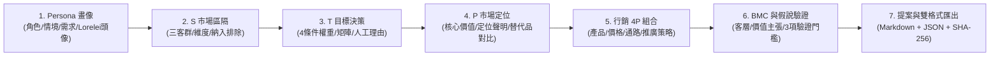

# AI 市場定位分析師 (行銷 STP & 4P) Web App

> **專為行銷人、產品經理、創業家與教學課堂打造的智能定位決策工作台**  
> 以 [Persona Designer](https://ai-persona-designer-v2.streamlit.app/) 為基準母版架構，採用 **GitHub + Streamlit + Google Gemini API Key (BYOK 0成本防護)** 模式全面實作。

---

## 🌟 核心特色與技術亮點

### 1. 0 成本 BYOK (Bring Your Own Key) 防護
- **完全零成本消耗**：發布給第三人或學員使用時，使用者於前端輸入個人 Google Gemini API Key，直接由瀏覽器會話端與 Google 官方端點通訊。
- **金鑰隱私安全**：API Key 絕不存入硬編碼、資料庫或任何第三方中介伺服器，頁面重整或關閉即消滅。
- **免費配額支持**：支援 Google AI Studio 免費個人額度即可順暢運行，小白用戶完全無須付費。

### 2. 多模型動態自動備援 (Failover & Fallback)
- **多模型支援清單**：優先支援 `gemini-2.5-flash`、`gemini-2.0-flash`、`gemini-1.5-flash`、`gemini-1.5-pro`、`gemini-flash`。
- **自動容錯降級**：徹底解決「咒語魔法書 1.0」因官方模型更迭下架導致失效的問題。遇到 404/429/配額限制時，底層自動依序重試備援模型，確保服務不中斷。

### 3. 極致 UI/UX 與小白行銷引導
- **現代視覺設計**：承襲母版頂級 Glassmorphism 玻璃擬態深色主題、漸層發光按鈕與卡片微光陰影。
- **7 步驟 Wizard 導航線條**：清楚標記當前階段，支援前後步驟自由跳轉。
- **DiceBear Lorelei 插畫大頭貼**：依據 Persona 姓名動態即時生成具視覺同理心的高質感頭像，並附帶 Bottts 備援。
- **小白心法提示卡 (Guide Alert)**：每步驟均附帶通俗易懂的行銷觀念與操作秘訣，新手不迷航。
- **一鍵載入示範案例**：內建「協作台 B2B SaaS」完整教學模擬案例，點擊一下即可秒懂全流程！

---

## 🧭 7 步驟閉環架構 (STP & 4P & BMC)



1. **Step 1: Persona 畫像**：角色定義、情境背景、剛性需求、現行作法、購買角色與約束；支援「✨ AI 幫我潤飾」與「✨ AI 全自動提煉」。
2. **Step 2: S 市場區隔 (Segmentation)**：劃分 S1、S2、S3 候選客群，明確界定維度、納入/排除條件、需求情境與接觸路徑；支援「✨ AI 智能推薦三客群」。
3. **Step 3: T 目標決策 (Targeting)**：四大條件與權重校正（總和嚴格 100%）、評分矩陣（1~5 分或 null 資料不足）、加權總分排序；有 null 缺值時自動切換「條件式決策 (conditional)」嚴防捏造數據；落實人工決策理由與取捨記錄。
4. **Step 4: P 市場定位 (Positioning)**：連動 T 選定客群，推演產品名稱、核心滿足需求、承諾價值、定位聲明（Statement）以及兩種替代方案之差異對比；支援下游重檢警示機制。
5. **Step 5: 行銷 4P 組合 (Marketing 4P Mix)**：特別授權核心亮點！推演出 Product (USP/包裝/調性)、Price (收費模式/價格帶/價值錨點)、Place (通路線/導入路徑)、Promotion (Slogan/內容切角/獲客 Hook)。
6. **Step 6: BMC 與假說驗證 (Verification)**：商業模式圖兩格串接（目標客層與價值主張）；擬定最多 3 項精實創業假說驗證行動，涵蓋指標、門檻理由、負責人與 if_false 策略。
7. **Step 7: 提案預覽與雙格式匯出**：版本歷程遞增 (v1 -> v2)；一鍵下載排版優美之標準 Markdown 報告 (`.md`) 與 Draft 2020-12 規範 JSON 資料檔 (`.json`)，兩檔具備相同 SHA-256 驗證指紋。

---

## 🚀 部署與本機啟動指南

### 本機運行
```bash
# 1. 進入專案目錄
cd /Users/wenanpan/.gemini/antigravity/scratch/marketing-stp-4p-app

# 2. 安裝相依套件 (若使用已備妥環境可略過)
pip install -r requirements.txt

# 3. 啟動 Streamlit 應用
streamlit run app.py
```

### GitHub + Streamlit Cloud 免費一鍵部署步驟
1. 將本專案目錄推送到您的 GitHub Repository。
2. 前往 [Streamlit Cloud](https://share.streamlit.io/) 並使用 GitHub 帳號登入。
3. 點擊 **"New app"**，選取剛建立的 GitHub 倉庫與分支。
4. 主程式路徑設定為 `app.py`。
5. 點擊 **"Deploy"**，約 1~2 分鐘內即可獲得公開可訪問的網址（如 `https://your-stp-4p-app.streamlit.app`）。

---

## 📋 驗收修改專用表格說明 (Excel)

專案根目錄附帶：
👉 **`市場定位分析_Web_App_驗收修改意見表.xlsx`**（亦可在 Web App 第 7 步驟中一鍵下載！）

### 表格架構：
- **Sheet 1: 專案驗收總覽**：母版對照、技術規格、BYOK 與多模型備援說明。
- **Sheet 2: 功能驗收與修改意見**：完整羅列 48 項測試點（F01~F10、STP、4P、BMC、BYOK、多模型、UI/UX），預留**「使用者驗收意見與修改需求 (反饋填寫區)」**。
- **Sheet 3: 業務規則檢核表**：BR01 至 BR11 的嚴格業務邏輯落實檢查。
- **Sheet 4: 驗收案例檢核表**：AC01 至 AC17 之 Given-When-Then 驗證清單。

**驗收方式**：您在實機體驗後，若有任何調整或優化想法，直接於該 xlsx 填寫意見並提供給我，我將立即為您依表迭代修正！
